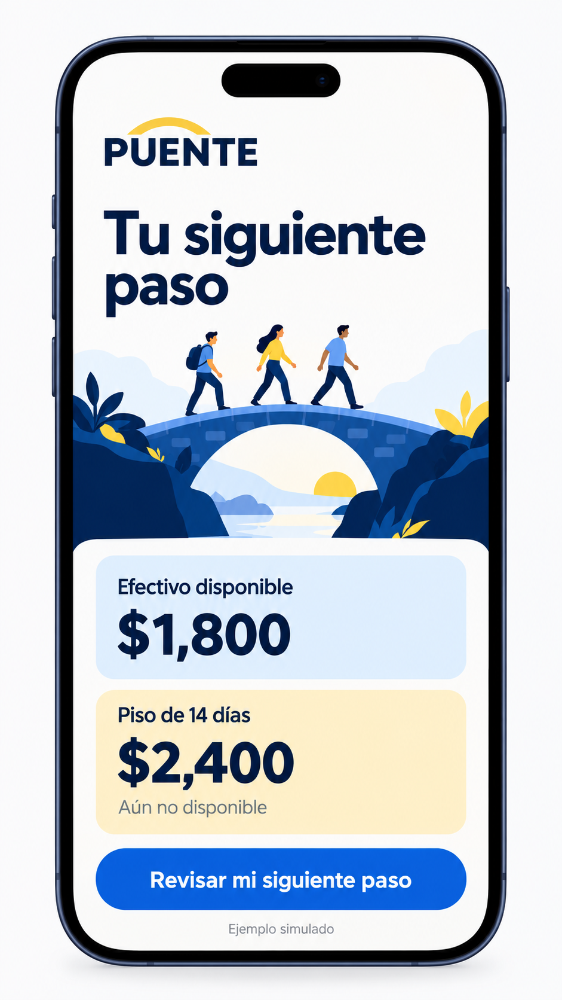
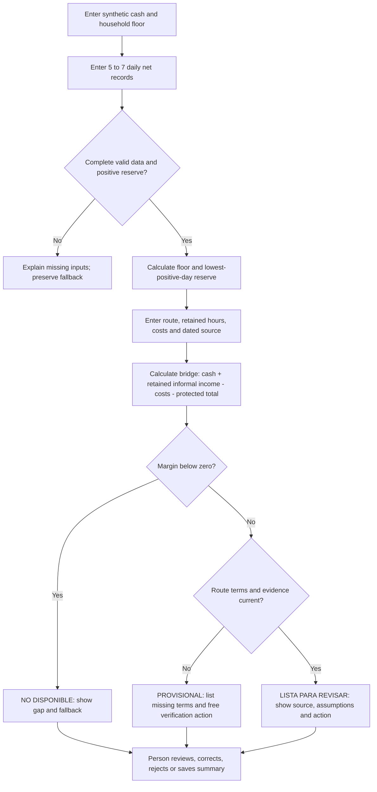
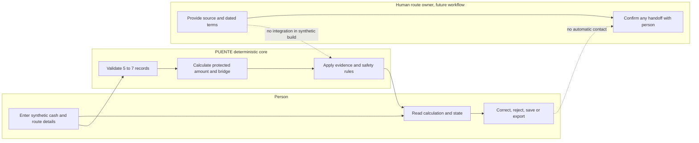

# PUENTE Week 12 Product Packet

**Owner:** Rodrigo Peña de León Pérez · **Role:** Technologist · **Source:** PUENTE, Week 4  
**Status:** pre-code specification for a synthetic core build. This packet does not represent a real interview, partner agreement, 10:1 result, completed test or deployment.

## 1. Problem and user

A person supported by informal daily work may see an attractive job offer but lack a way to understand the cash gap before the first salary: household expenses, a reserve, the loss of informal working hours and onboarding costs arrive before pay. PUENTE's initial user is a Spanish-speaking informal worker using a phone who wants to compare a possible job or training route with continuing the present income path. Luis, the example used here, is invented.

## 2. The bounded core and success

**One sentence:** turn cash constraints and dated route evidence into an explainable route state, a safe next action, and an editable record while the person retains the choice.

**Course-method engine:** Step 5, *Build one bounded loop*: validated inputs → deterministic rule → interpretable state → action → correctable record. Step 6 requires a human decision; Step 7 tests the assumptions and the competing workaround.

**Success before the module closes:** the synthetic user completes one end-to-end flow on a mobile screen, sees the protected floor and reserve, recognizes the reason for the state, finds one next step and saves or exports an explicitly simulated result. A successful software run is not proof of actual demand or 10:1 advantage.

## 3. Generated design mockup

This Week 12 image-generated concept explores a cobalt and yellow startup identity and a mobile decision view. Its amounts are synthetic, and the screen is a visual concept rather than evidence of a tested workflow. The production flow calculates the full bridge, including reserve, transition costs and any informal income retained; the illustration compares only the initial cash and basic floor.

The earlier [Week 4 concept board](assets/puente-week4-generated-reference.png) is preserved for reference.

## 4. Deterministic flow

**14-day formula:** `protected = 2 × weekly household floor + lowest positive valid daily net`. `retained informal income = (weekly valid net / weekly recorded hours) × retained hours per week × 2`, when all inputs are valid. `bridge margin = available cash + retained informal income − transition costs − protected`. Lost informal earnings are already reflected by retained hours and must not be deducted twice. Any unconfirmed future formal wage contributes MXN 0 to the bridge.

## 5. Actors

## 6. Benchmark and differentiation

**Global reference, not a claim of worldwide superiority:** Singapore's [Careers & Skills Passport](https://www.myskillsfuture.gov.sg/csp) aggregates employment, qualifications and skills records from verified sources, allows a person to share their data, and links to career transition and training recommendations. It demonstrates how provenance and consent can support a person's career pathway.

**Mexico reference:** the official [Portal del Empleo](https://www.empleo.gob.mx/jobs) offers job search, employer vacancies, events and training resources. It is a potential route-discovery reference, not an integrated PUENTE data source.

**PUENTE's proposed localization:** a Spanish, phone-first decision layer that exposes the 7/14-day cash bridge for irregular income and retains a fallback while source status remains visible. This differentiation is a hypothesis; the listed pages do not by themselves prove that neither service has an equivalent tool, that PUENTE is better, or that anyone would use or pay for it. The assignment's wording “best existing solution on Earth” remains a judgment to substantiate through further research, not an established fact.

## 7. Three-year view

If the core flow is useful, PUENTE could coordinate accurate, maintained work and training routes across trusted community partners. People could carry a correctable decision record and opt into a human handoff without losing control over their current income plan. A wider network is justified only if real participants, operators and route owners can demonstrate safe outcomes, reliable evidence and sustainable economics.

## 8. Product requirements

### Required core

1. Collect 5–7 dated or clearly ordered daily sales records, available cash and weekly household minimum; validate currency, dates, hours and required fields.
2. Display daily and weekly net, recorded hours, reserve, 14-day protected amount and assumptions; prevent completed assessment on insufficient data.
3. Collect one route's retained informal hours, itemized transition costs, timing, named source and date. Treat unconfirmed salary as zero during the bridge.
4. Apply the deterministic cash rule and evidence precedence described in [CHARTER.md](CHARTER.md). Display `NO DISPONIBLE`, `PROVISIONAL` or `LISTA PARA REVISAR` with a traceable reason and visible fallback.
5. Allow correction, rejection and a saved/exported summary. Make actual storage behavior explicit: a local export or browser record is not a remote database. Before any personal server storage, enforce consent, auth and user-specific access.
6. Present synthetic data and fabricated routes as synthetic, provide an accessible mobile layout, and never imply that a listed route is currently available or that employment is guaranteed.

### Outside scope

No real applications, outbound messages, identity collection, verified job feed, subjective employability scores, unattended AI decisions, partner integration or inferred qualifications. No feature expansion beyond the bounded core.

## 9. Architecture and stack plan

| Layer | Intended floor / design | Current evidence |
|---|---|---|
| Client | Next.js / React, Tailwind, Spanish mobile-first interface | Target; report actual implementation separately |
| Decision | Pure, typed deterministic functions over validated numbers and dated evidence | Defined above; no result is claimed tested in this packet |
| Persistence | Supabase with authenticated user isolation and RLS if personal data is ever stored; otherwise clearly labeled local synthetic state/export for initial exercise | Target; no server persistence or account is claimed by this specification |
| Source and hosting | GitHub repository, Vercel deployment and venture domain | Required targets; no repository, purchased domain or deployed Week 12 URL is claimed here |
| Explanation | Optional server-side LLM text rewrite only after deterministic calculation, never allowed to change decisions; secret stored server-side | Optional; no provider, key or live model call is claimed |

Never embed keys in source or client bundles. Validate every input; if storing personal data, enable authentication and row-level security. The user must see the limits of the route information. Use fictional fixtures in public demos.

## 10. Acceptance criteria and test plan

1. Fewer than five complete daily records produces a clear incomplete state, without a protected amount presented as verified.
2. Five to seven valid records with at least one positive net calculate the lowest positive-day reserve and the 14-day household floor without negative/non-finite inputs.
3. A route with a negative margin shows `NO DISPONIBLE`, the gap, a no-cost next step and a fallback even when evidence fields are present.
4. A route with a non-negative margin but missing or stale source/terms is `PROVISIONAL`, not verified.
5. A non-negative margin with all documented terms yields `LISTA PARA REVISAR` and shows the source and assumptions; it does not imply independent institutional verification.
6. Changing hours or costs recomputes the bridge; lost income is not subtracted twice; unconfirmed formal salary does not finance the bridge.
7. The user can review the saved/exported record, correct data or reset, and the UI states whether storage is browser-only or server-backed.
8. Numeric boundaries, empty fields, zero hours, invalid dates and accessible 360 px layout are checked. Record actual commands and observed results; a bug/fix/redeploy claim requires an actual recorded cycle.

**Synthetic persona pass:** follow [PERSONAS.md](PERSONAS.md) through screenshots in a fresh conversation; save the resulting confusion log, the worst issue and any actual fix and retest. No run is claimed in advance.

## 11. Delivery and open checks

The course calls for a real domain, live URL and GitHub link, `DEMO_yourname.mp4`, `PACKET_yourname.pdf`, `PERSONA_yourname.pdf` and `BUILDCHAT_yourname.pdf`, including a real test-fix-redeploy history. Verify the current Brightspace requirements and the Team Blueprint conditions before submission. Record actual project choices, commits, deploys and outcomes; do not invent them. The real-user gate, 10:1 evidence, team confirmation, simulated-persona test, any newly required Week 12 mockup, deployment and video remain to be established.

**Sources:** prior Week 4 [product packet](../../../../semana_04_when_the_tutor_knows_your_child_better_than_you_do/03_business_bending/puente-w4/site/docs/PACKET.md), the Week 12 Method/Verdict materials, [MySkillsFuture](https://www.myskillsfuture.gov.sg/csp), and [Portal del Empleo](https://www.empleo.gob.mx/jobs). Any date-based availability must be rechecked before a real handoff.
