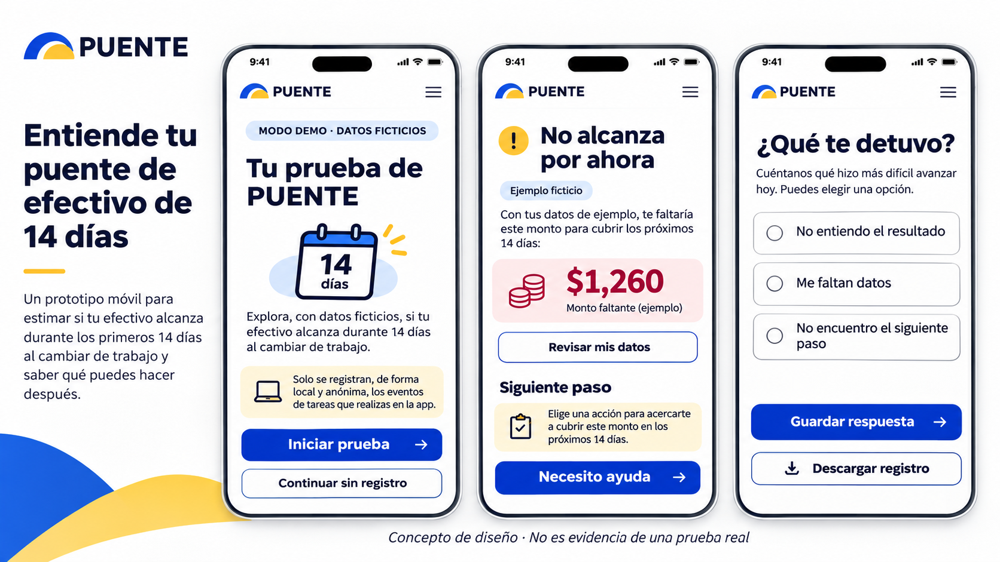
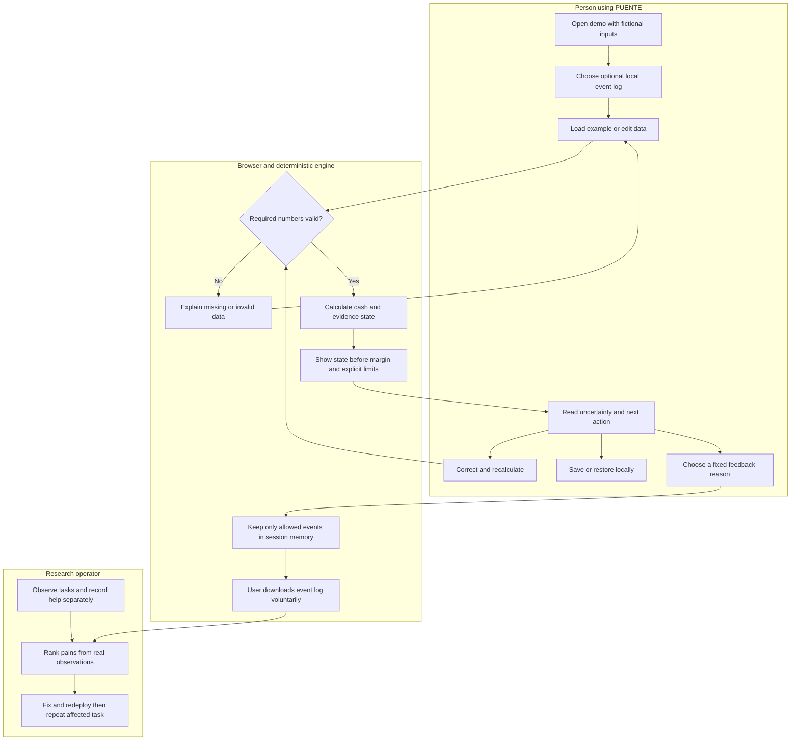

# PUENTE Week 13 Product Packet

Owner: Rodrigo Peña de León Pérez | Operator | November 4, 2026

## Problem and exact user

A worker with irregular income needs to understand the household cash gap before changing work. A correct number is insufficient if a positive margin is mistaken for an employer's approval. The user is an adult considering a work or training transition, using a phone in Spanish, who needs an understandable result, a correctable record and a next verification step.

## Evidence and priority

The authoritative source is Rodrigo's supplied PUENTE_W13.pdf, eleven pages, confirmed by Rodrigo as five real sessions on November 4. Earlier uploads are superseded. The source retains an obsolete heading on page 4; the user's explicit correction governs the classification of the sessions. Participant details and results are reported by Rodrigo, not independently witnessed by this assistant. Public material will use codes and task findings, not identifying biographies.

The record contains five adults, three previously unknown to the interviewer, with 25 task attempts: 18 completed without help, six with help and one not completed. Completion is distinct from comprehension. These figures describe this sample, not a population estimate.

1. Positive margin as approval: U02 and U04 misinterpreted T4; U01 understood it partially. This threatens the product's central purpose and is the first correction.
2. Retained income of zero as a judgment on work: U04 misread the row; U01 also confused the result with acceptance/rejection. Show recorded net and retained projected income separately, without implying the recorded days are verified earnings.
3. Loading versus restoring: U01 and U03 used the initial example to recover work; U02 hesitated. Use distinct actions and explain browser-local storage.

Technical issues reported include empty numbers converted to zero, immediate clearing, a stale example-loaded message, an unexplained reserve and a disappearing result on edit. Reproduce each before recording a fix.

## Weekly success and acceptance

Before the module closes, the same fictional input must still produce -MXN 1,260 and +MXN 240. The positive provisional state must prominently state that information remains unconfirmed and that PUENTE has not verified the opportunity. Missing numeric input must not become zero. Saving/restoring, confirmation before clearing and a local feedback log must work in desktop and mobile views.

Technical acceptance does not establish improved human comprehension. Repeat T3/T4 with real participants after deployment and record their explanations before offering help. Preserve the original five-session record unchanged. A subsequent voluntary message or repeat visit is still needed to strengthen return evidence; three verbal intentions do not prove repeat use.

## Image generated mockup

Generated before implementation using the built-in image tool. This is a design reference, not a shipped screenshot. Preserve the existing PUENTE brand and navigation. The implementation must describe actual local storage precisely and follow the deterministic next action rather than copying the mockup's generic advice.

## Flow and actors

## Benchmark and localization

The closest reference for cash timing is CFPB's weekly cash-flow budget; YNAB's irregular-income guide reinforces allocating actual available money. PUENTE localizes this discipline into a mobile Spanish transition calculation in MXN, with dated source information, an uncertainty state and the current-income fallback. This is a bounded design difference, not evidence of superiority or absence of competing tools in Mexico.

Sources carried from Brain: https://www.consumerfinance.gov/documents/10038/cfpb_creating-cash-flow-budget_tool_2021-08.pdf and https://www.ynab.com/guide/irregular-income .

## Long view

If the bounded transition tool proves useful, PUENTE could support maintained pathways and opt-in handoffs to community organizations. The worker would retain a correctable record while each institutional claim identifies its accountable source. Expansion requires demonstrated comprehension, real operating capacity and measured value rather than a growing catalogue of generated opportunities.

## Scope and architecture

Keep the deterministic engine and 14-day rules unchanged. Change presentation, numeric parsing, local record handling and optional feedback. Do not add a job marketplace, wage prediction, independent employer verification, live chat, login, new database writes, generative recommendations or a promise of employment.

| Layer | Week 13 decision |
|---|---|
| UI | Existing Next.js 16 / React 19, Spanish mobile-first interface |
| Calculation | Existing pure TypeScript engine; separate presentation helpers |
| Saved example | Existing browser-local key for backward compatibility; no server write |
| Feedback | Explicit opt-in, session-memory log, fixed reasons, voluntary JSON export; no entered cash, names, route text or identifiers |
| Existing server | Curated fictional example read only; no change to Supabase access |
| Publishing | Existing GitHub/Vercel project; preserve current production until verified deployment |

User data entered in the demo remains fictional. Optional feedback must not make external requests. No personal information goes into demo seeds, source control or analytics. Keep authentication and row-level protections if real personal-data persistence is introduced later; it is outside this slice.

## Test plan and implementation sequence

1. Commit this packet and implementation prompt before app changes.
2. Reproduce empty input and state wording; add narrow numeric/presentation regression tests.
3. Fix hierarchy, income labels, reserve explanation and result-stale notice; retain numerical outputs.
4. Separate loading/restoring, preserve old storage compatibility, clear stale notices and require explicit confirmation before deletion.
5. Add optional bounded feedback log and test consent, schema allowlist and exclusion of financial values.
6. Run the existing engine tests, new regressions and production build; inspect at 386 px and desktop, plus keyboard interaction.
7. Record actual commit/deploy identifiers and screenshots. Repeat affected human tasks after deployment; do not substitute automated checks for participant retesting.

## 10 to 1 and evidence boundary

Retain the Week 12 conditional cohort model: 20 participants, eight feasible pathways at MXN 25,000 attributable operating value each, and MXN 20,000 full costs; MXN 200,000 / MXN 20,000 = 10:1. These economic inputs remain hypothetical. Real usability sessions do not transform that model into measured ROI. The Luis input used on screen is a fictional calculation fixture; the people conducting the reported tasks are real per Rodrigo's clarification.
