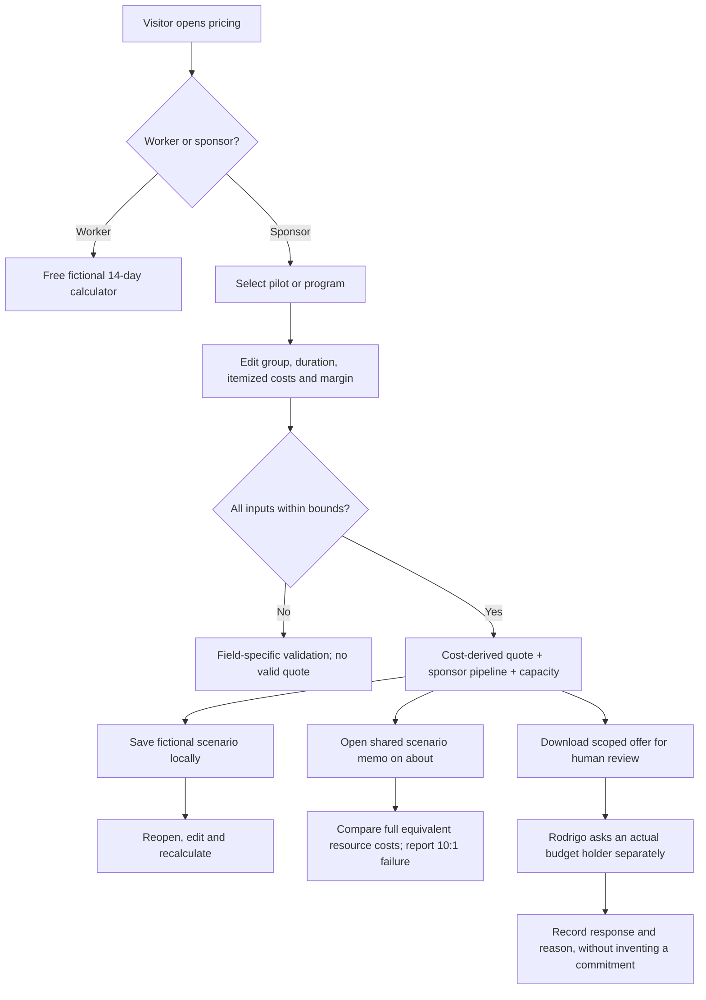
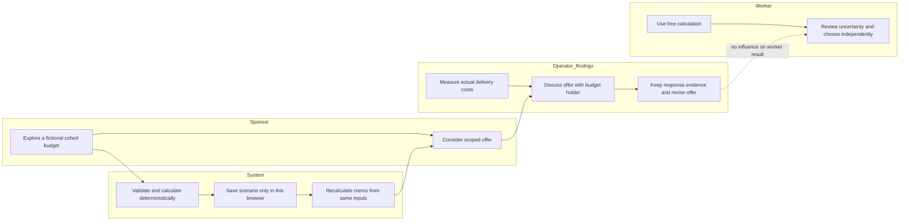

# PUENTE W14 - Sponsored Access

Prepared 13 November 2026, before application implementation on branch `codex/puente-week14`. Owner: Rodrigo Peña de León Pérez, Technologist.

## Problem in my words

The worker should not pay to discover whether a transition fits a fragile household cash horizon. A sponsor can fund access, but free access has a delivery cost and no sponsor has yet committed. The product must make the proposed service, costs, capacity and independence legible before asking anyone to finance it.

## Exact user and payer

Beneficiary: Spanish-speaking worker considering a work/training transition, using the existing 14-day fictional calculator. Payer: foundation, company or institution considering funding a bounded cohort. Two segments: worker and institutional sponsor. No organizational relationship, real budget holder or willingness to sponsor is assumed. The public prototype uses invented scenario numbers only; never enter personal financial records or participant names.

## Success before the module closes

`/pricing` explains three offers (worker free / sponsored pilot / sponsored program); its calculator derives the quote from itemized costs, duration and a visible margin; it separates sponsor prospects, expected conversion, reported signed agreements, participant capacity and cash received. Two different fictional scenarios survive reload, reopen and edit. `/about` uses the same calculation and inputs, shows a one-page 10:1 memo and explicitly reports when it fails. Worker calculation, safety warnings and independent decision remain available without sponsorship. Public demo source and build pass checks. Publication and real payer conversation remain separate external steps.

## Blueprint received and scope

Source: `02_team_bending/fuente/BLUEPRINT_team_RECIBIDO_2026-11-13.pdf` in the W14 delivery folder; exact original copied from Rodrigo's attachment. It is three pages and labels itself a proposed synthesis, without live votes, concessions or video. Rodrigo authorized continuing with it. Applying its conditions does not certify a completed meeting or fix its one-page submission requirement. Current team: Andrés / Criba; Rodrigo / PUENTE; Regina / Family Shield; Sebastián / FieldProof; Isidro / Aqua Retail. Preserve different ventures and models.

| Condition | Implementation and evidence |
|---|---|
| 1. Separate payer and beneficiary | Named segments, free worker card, sponsor-funded offer; no charge to worker. |
| 2. Real alternative and incremental value | Editable same-task/group/period baseline in memo; worksheet + support alternative; no superiority claim. |
| 3. Behavior, not praise | Visible no-commitment status; template for actual budget-holder response. No fake purchase, sponsor or accepted proposal. |
| 4. Full cost | Setup, per-person onboarding, monthly support and infrastructure, evaluation and acquisition; margin distinct from profit. |
| 5. Access and independence | Existing deterministic worker engine unchanged; no paywall; sponsor does not access participant records. |
| 6. Shadow clause | No safety, employment, identity or outcome guarantees; fictional inputs, 14-day boundary, no sponsor influence. |

## Image-generated mockup

`assets/PUENTE_W14_SPONSORED_MOCKUP.png` (copied into this repository before the packet commit) is a preimplementation concept generated with the built-in image tool. It is not a screenshot of working software. Prompt and generation provenance are retained in `docs/MOCKUP_WEEK14.md`. The image illustrates the three offers and itemized quote/saving controls; delivered HTML may differ for clarity and accessibility.

## Feature flow and actors

## Benchmark and three-year view

The closest funded-access business-model reference is EVERFI's community/business-funded educational access (https://support.everfi.com/everfi-cost). PUENTE localizes a beneficiary/funder separation to Spanish adult workers and a first-pay gap, without claiming EVERFI's distribution, outcomes or Mexican sponsor demand. Functional reference: CFPB Your Money, Your Goals cash-flow worksheets (https://www.consumerfinance.gov/consumer-tools/educator-tool/your-money-your-goals/toolkit/); a worksheet with assistance remains a real alternative.

If this bounded pilot works, PUENTE could support independent transition planning through local delivery partners. Sponsor renewal would depend on measured comprehension, useful access and a sustainable service budget, with worker-controlled records and accountable human sources. Expansion would require privacy/authentication and actual partner capacity before remote participant storage or sponsor reporting is built.

## Pricing and economics contract

One shared TypeScript module owns defaults, plan scopes, labels, limits, cost calculation, pipelines and comparison. All inputs are fictional/editable assumptions, not market rates. No MXN 490/1,490 subscriptions. No checkout or sponsor dashboard.

Pilot example: 20 participants, 1 month; Program: 60 participants, 3 months. Scope changes alter quote inputs, not worker safety. Price = full provider cost / (1 - target margin). Staff cost = (setup hours + group onboarding hours + monthly support x months + evaluation hours + acquisition hours) x hourly cost. Onboarding = participant count x onboarding hours per participant. Infrastructure is monthly x months. No unpriced staff time. Quote is a contract price in MXN, not per-worker billing; tax handling is explicitly outside the prototype estimate. Contribution is quote minus listed delivery costs, not net profit.

Expected agreements = sponsor prospects x assumed conversion / 100 (fractional expectation is permitted and labeled). Signed agreements are a separate manual fictional count, never inferred from expected conversion. Expected contract value, reported signed value and cash entered as received are separately labeled; application verifies none. Duration-normalized monthly and annual equivalents assume repeated contracts at the same pace; they are not booked revenue, forecast or promised renewal.

Participants possible = agreements x cohort size, bounded by declared delivery capacity; show shortage rather than silently increasing capacity. Baseline comparison covers same task, cohort and contract duration. Full resource cost with PUENTE = listed provider delivery cost + residual buyer staff time + participant time. Do not add the sponsorship price on top of delivery resources it already finances. Show incremental sponsor spend separately if needed. Risk remains descriptive and unmonetized. Unknown or zero denominator has no numerical ratio; failures of the 10:1 threshold remain visible. This is scenario arithmetic, not proof.

## Scope cut

No checkout, billing integration, signed agreement verification, personal records, employer verification, sponsor access to worker data, tracking analytics or production impact dashboard. No new remote database; no Supabase changes. No claims of live meeting, personal debate duration, actual payer conversation, confirmed sponsorship or 10:1. This chat is the actual implementation discussion; no synthetic BUILDCHAT replacement. Course asks a new conversation in the weekly Project: local packet chronology is recorded here, but continuing this user-authorized chat does not establish that separate-conversation requirement.

## Architecture and stack

| Layer | Choice | Boundary |
|---|---|---|
| Pages | Existing Next.js App Router + React + TypeScript | `/pricing`, `/about`; root links added. |
| Engine | `lib/sponsorship.ts` pure functions | Single economics source, explicit bounds and finite numbers. |
| Storage | Versioned allowlisted localStorage scenarios | Max 8 fictional named scenarios; no accounts or synchronization. |
| Memo | Same engine + selected saved scenario | No stale hardcoded prices, print one-page memo. |
| Styles | Existing royal blue/navy/yellow system, scoped sponsorship CSS | Mobile fields, visible focus, accessible labels/status. |
| Tests | node:test plus browser acceptance | Manual formulas, invalid input, mismatched capacity, corrupted/failed storage, cross-page same scenario. |

## Test plan and acceptance criteria

1. Check baseline existing tests before application changes; record output.
2. Verify manual quote arithmetic, margin vs markup, multi-month cost and two package presets; zero sponsors, conversion 0/100%, no double-counted workers, cash distinct from contract value.
3. Reject blank/nonfinite/negative, excessive or fractional group sizes, margin >=100%, excessive text, unknown stored fields, corrupted version or invalid scenario. Avoid misleading valid totals after invalid input.
4. Bound and visibly show capacity shortfall. Unfunded demand is not funded participants; free access is not costless.
5. Save scenario A, edit and save B, reload, reopen A, edit/recalculate, open its exact memo and compare numbers. On inaccessible/quota storage, show error and preserve download; no false success toast.
6. Mobile at ~390px: three offers legible, fields and actions usable, no horizontal overflow; keyboard labels, field errors, focus and status feedback.
7. Preserve existing worker results, loading/saving and 14-day uncertainty. No new network data transmissions, secrets or personal data.
8. Identify an actual bug during mechanical/visual testing, record observed failure, fix, retest. Do not invent a bug. Two external deploys and fresh independent visual PERSONA remain separately evidenced stages.
9. Product and exact evidence links must open without the owner's session before submission. Domain, published URL, payer response and videos are not fabricated by a local build.

## Implementation prompt and commits

Implement in small independently reviewable steps after this packet commit: (1) packet/mockup, (2) pure economics engine + meaningful tests, (3) pricing/scenario UI, (4) shared memo + navigation, (5) measured fixes and verification records. A sixth commit is fine when justified; no artificial commits solely to pad count. Preserve existing worker engine. End session with DECISIONS.md, tests, current commit, deployment status and next action.
